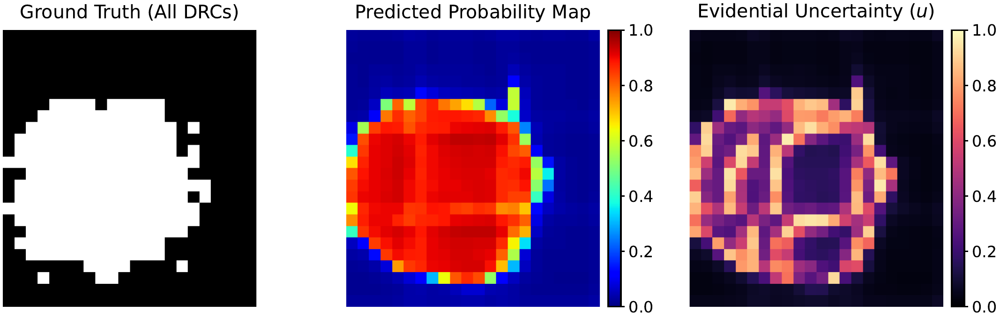

# LiteDRC

Lightweight cross-PDK regional Design Rule Checking (DRC) hotspot prediction with Beta Evidential Deep Learning (EDL) for epistemic uncertainty estimation.

<p align="center">
  
  <br>
  <em>Full-chip regional DRC prediction and Beta-EDL epistemic uncertainty (<i>u</i>) on <code>sky130</code> (<code>keccak</code> design).</em>
</p>

LiteDRC takes `64 × 64` pre-CTS physical feature patches (`RUDY`, `pin_density`, `placement_density`, plus optional `VDD`/`VSS` power-grid distance channels) conditioned on PDK metadata and predicts 3-class DRC violation maps (`Metal Spacing`, `Short`, `Other`) on an `8 × 8` regional GCell grid.

---

## Installation

1. **Clone the repository and create a virtual environment:**
   ```bash
   git clone <repo-url>
   cd LiteDRC
   python3 -m venv .venv
   source .venv/bin/activate
   ```

2. **Install PyTorch and dependencies:**
   ```bash
   pip install --upgrade pip
   pip install -r requirements.txt
   ```
   *(For CPU-only environments, install PyTorch first via `pip install torch --index-url https://download.pytorch.org/whl/cpu`.)*

3. **Install `litedrc` in editable mode:**
   ```bash
   pip install -e . --no-build-isolation --no-deps
   ```

---

## Configuration & Dataset Layout

Default hyperparameters live in `configs/default.yaml`:

```yaml
model:
  in_channels: 3       # 3 (RUDY, pin, placement) or 5 (+ VDD/VSS distance maps)
  num_classes: 3       # [Metal Spacing, Short, Other]
  base_filters: 32
  pdk_dim: 9
  num_pdks: 4
  pdk_embed_dim: 8
  drop_prob: 0.15
  use_film: true

data:
  patch_size: 64
  window_size: 8
  samples_per_file: 5

training:
  batch_size: 512
  epochs: 200
  lr: 0.0002
  weight_decay: 0.01
  annealing_epochs: 50
```

Processed datasets passed via `--data-root` are expected to follow a Leave-Design-Out split:

```text
<DATA_ROOT>/
├── train/
│   ├── global_zscore_stats.json
│   └── *.npz
└── val/
    └── *.npz
```

---

## Usage & Workflows

### 1. Data Preprocessing & Normalization Statistics

Convert raw OpenROAD physical feature maps and DRC reports into `.npz` design chips, then compute training-set Z-score statistics:

```bash
python scripts/preprocess_data.py \
  --targets-root /path/to/raw_targets \
  --features-root /path/to/raw_features \
  --output-dir /path/to/processed_dataset \
  --val-size 0.15

python scripts/collect_stats.py \
  --data-dir /path/to/processed_dataset/train
```

### 2. Cross-PDK Zero-Shot Training

Train a regional DRC predictor on a source PDK (`gf180` or `sky130`) and validate zero-shot transfer on a target PDK:

```bash
# Evidential Deep Learning with PDK Cross-Attention (gf180 -> sky130)
python scripts/train_zero_shot.py \
  --train-pdk gf180 \
  --test-pdk sky130 \
  --cond cross_attn \
  --loss edl \
  --data-root /path/to/processed_dataset \
  --out-dir outputs/gf180_to_sky130_edl_attn

# With 5-channel power-grid distance maps (VDD/VSS)
python scripts/train_zero_shot.py \
  --train-pdk gf180 \
  --test-pdk sky130 \
  --cond film \
  --loss focal \
  --use-distances \
  --data-root /path/to/processed_dataset \
  --out-dir outputs/gf180_to_sky130_dist
```

Supported `--cond` options: `none`, `film`, `cross_attn`. Supported `--loss` options: `edl`, `focal`.

### 3. Zero-Shot Evaluation

Evaluate any checkpoint on a target PDK:

```bash
python scripts/eval_zero_shot.py \
  --test-pdk sky130 \
  --cond cross_attn \
  --weights ckpt/zero_shot/gf180_to_sky130_edl_cross_attn.pth \
  --data-root /path/to/processed_dataset
```

### 4. Few-Shot Transfer Learning & Plotting

Fine-tune pretrained source-domain checkpoints across target-domain data fractions (`1%`, `5%`, `10%`, `25%`, `100%`) and generate publication plots:

```bash
python scripts/train_few_shot.py \
  --target-pdk sky130 \
  --data-root /path/to/processed_dataset \
  --out-csv outputs/few_shot_results.csv \
  --max-steps 500 \
  --eval-every 25

python scripts/plot_few_shot.py \
  --input-csv outputs/few_shot_results.csv \
  --out-pdf outputs/few_shot_curve.pdf \
  --out-png outputs/few_shot_curve.png
```

### 5. Full-Chip Visualization & Runtime Benchmarking

Inspect available validation chips (omit `--file-idx` to list indices) and render aggregated or per-class hotspot + uncertainty maps:

```bash
# List available chips for sky130
python scripts/visualize_chip.py \
  --pdk sky130 \
  --test-dir /path/to/processed_dataset/val \
  --stats-path /path/to/processed_dataset/train/global_zscore_stats.json \
  --ckpt ckpt/zero_shot/gf180_to_sky130_edl_cross_attn.pth

# Render per-class predictions for chip index 0
python scripts/visualize_chip.py \
  --pdk sky130 \
  --file-idx 0 \
  --mode per_class \
  --test-dir /path/to/processed_dataset/val \
  --stats-path /path/to/processed_dataset/train/global_zscore_stats.json \
  --ckpt ckpt/zero_shot/gf180_to_sky130_edl_cross_attn.pth \
  --save-dir outputs/chip_vis
```

Measure end-to-end inference runtime on raw design files:

```bash
python scripts/benchmark_runtime.py \
  --targets-root /path/to/raw_targets \
  --features-root /path/to/raw_features \
  --ckpt ckpt/zero_shot/gf180_to_sky130_edl_cross_attn.pth
```

---

## Pretrained Checkpoints (`ckpt/`)

| Path | Loss | Conditioning | Description |
| :--- | :--- | :--- | :--- |
| `ckpt/zero_shot/gf180_to_sky130_edl_{none,film,cross_attn}.pth` | Beta EDL | None / FiLM / Cross-Attn | Zero-shot `gf180` → `sky130` |
| `ckpt/zero_shot/sky130_to_gf180_edl_{none,film,cross_attn}.pth` | Beta EDL | None / FiLM / Cross-Attn | Zero-shot `sky130` → `gf180` |
| `ckpt/few_shot/gf180_to_sky130/fft_frac_{0.01..1.0}.pth` | Beta EDL | Fine-tuned | Few-shot transfer `gf180` → `sky130` |
| `ckpt/few_shot/sky130_to_gf180/fft_frac_{0.01..1.0}.pth` | Beta EDL | Fine-tuned | Few-shot transfer `sky130` → `gf180` |
| `ckpt/ablations/focal_3ch/` | Focal | None / FiLM / Cross-Attn | 3-channel cross-PDK ablation |
| `ckpt/ablations/focal_5ch_dist/` | Focal | None / FiLM / Cross-Attn | 5-channel (+ VDD/VSS distances) ablation |
| `ckpt/ablations/multi_pdk/` | Focal | None / FiLM / Cross-Attn | Joint multi-PDK oracle baselines |
